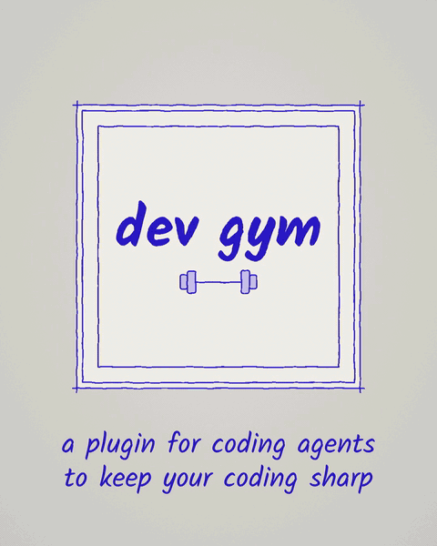

# dev gym

**Your coding agent stops writing code for you and starts training you.**

It builds you a small, real practice project. It keeps the tests that grade you hidden. It reviews your code like a strict senior colleague and levels you up, topic by topic. You write the code yourself, in your own editor, with AI switched off.

<p align="center">
  
</p>

## Install

```sh
npx skills add keyboardsamurai/dev-gym -g
```

This finds the coding agents on your machine (Claude Code, Codex, Cursor, OpenCode and many more) and puts the skill where each one looks for skills. `-g` installs it once for your user instead of per project. It needs Node 22.20 or newer.

Then say **"dev gym"** to your agent.

Other ways to install:

- **Claude Code plugin:** run `/plugin marketplace add keyboardsamurai/dev-gym`, then `/plugin install dev-gym@dev-gym`.
- **By hand:** copy the `skills/dev-gym` folder into your agent's skills folder. For Claude Code that's `~/.claude/skills/`.

## Why this exists

Coding agents write more and more of our code. Someone still has to understand that code, at the latest in code review. You judge code best when you could have written it yourself. And that is exactly the practice many developers are losing right now.

dev gym keeps it alive. It gives you short, realistic rounds with honest grading and no AI help.

## What a round looks like

The five rooms in the animation are the five steps.

### 1. Warm-up: a short interview

The first time, the agent asks what you want to train:

- **Your stack:** language, framework, versions, build tool, database. Any stack works.
- **Topics:** it proposes 6 to 9 topics that matter in production for that stack. You edit the list.
- **Starting level:** a number from 1 to 10, or "auto". With auto, every topic starts at 3 and your first three rounds move you up or down twice as fast, so you land at the right level quickly.
- **Where your projects go:** default `~/devgym`.
- **Allowed tools:** by default your IDE, normal autocomplete, compiler, debugger, tests and official docs. Not allowed: AI assistants, Stack Overflow, copied solutions. You can change this.

It then checks that your toolchain is installed and proves it can create an empty project that builds.

### 2. Workout: a real project on disk

Each round you choose:

- **Debug it:** code that's broken, misbehaves in production, or needs cleaning up.
- **Build it:** a component or feature to implement.
- **Surprise me.**

The agent creates a small project in its own folder, as a git repo. Inside:

- `CHALLENGE.md`, the brief. It starts with the task, names the files to edit, and says how you know you're done.
- Starter code and a few visible tests.
- Files that switch off AI in common editors: `.noai` (JetBrains AI Assistant), `.cursorignore` (Cursor), `.aiexclude` (Gemini Code Assist), and VS Code settings that turn off Copilot and the built-in AI chat.

Before it hands the round over, the agent builds the project and runs every test itself. That way the brief never claims something the code doesn't do.

You code in your own editor. The agent waits.

While a round is running, the agent is a referee, not a pair programmer. If you ask it for help with the challenge, that counts as a hint and costs XP. It tells you before it answers, so you can back out. Questions about the requirements are free, and it answers them like a product owner would.

### 3. Lockers: hidden tests

Besides the visible tests, the agent writes 2 to 5 hidden tests. They target the cases people tend to miss: limits, duplicates, two requests at the same time, a failure halfway through, bad input. They live outside your project folder, so they stay out of sight while you work.

### 4. Review: graded like a strict senior colleague

When you say `submit` (optionally with a few lines on your approach), the agent:

1. reads exactly what you changed since the starter code,
2. runs your visible tests,
3. copies the hidden tests in, runs them, and removes them again in the same step,
4. scores you on four things, 0 to 3 points each.

| Criterion | The question it answers |
|---|---|
| Correctness | Does it do what was asked, and pass the visible and hidden tests? |
| Code quality | Clear names, sensible structure, idiomatic use of the language and framework, nothing needlessly complicated? |
| Robustness | Edge cases, errors, concurrency, behaviour when something fails? Good questions asked before you started count here. |
| Testing | Do your own tests cover the risky parts, and would they catch a regression? |

Each point in the review starts with what goes wrong ("under real traffic every page view re-sorts 500k terms"). Then comes the cause, with the file and line. After that you see the hidden test results and, if you missed something important, the key part of a reference fix.

A Pass means "I'd approve this pull request with comments". Scores aren't inflated.

### 5. Level up

You earn XP, and each topic levels up on its own. The scoreboard shows where you stand:

```
🏋️ Dev Gym · Java/Spring · Overall L4 Journeyman · 1,180 XP · Streak 🔥 2
Core Java      ▰▰▰▰▱▱▱▱▱▱ L4
Concurrency    ▰▰▱▱▱▱▱▱▱▱ L2  (1 pass toward L3)
Data/Tx        ▰▰▰▰▰▱▱▱▱▱ L5  ⚔️ boss pending
Weak spots: no test for concurrent access, swallows exceptions
```

## Scoring and levels

| Score out of 12 | Verdict |
|---|---|
| 0 to 6 | Fail |
| 7 to 9 | Pass |
| 10 to 12 | Excellent |

**XP for a round** = topic level × 20, then × 0.25 for a Fail, × 1 for a Pass, × 1.5 for an Excellent. Each hint takes 20% off. Your streak counts Passes and Excellents in a row. A Fail resets it, a skip doesn't.

**Each topic has its own level from 1 to 10.**

- It goes **up** after two Passes in a row at your level, or one Excellent.
- It goes **down** after two Fails in a row, never below 1.

The level decides what the rounds look like:

| Level | Rank | What a round looks like |
|---|---|---|
| 1 to 2 | Apprentice | One or two classes. A complete spec. All tests given. |
| 3 to 4 | Journeyman | A small feature across layers. Some tests given, you write the rest. Bugs show up as failing tests. |
| 5 to 6 | Senior | Bugs show up as production symptoms ("customers are charged twice under load") with no failing test. You reproduce the bug, write the test, then fix it. Some requirements are left open on purpose. Asking about them earns points. |
| 7 to 8 | Staff | Several stages in the same folder. After each submission a requirement changes or something starts failing. You explain your tradeoffs in writing. |
| 9 to 10 | Principal | Open-ended. You design the interfaces, data model and tests. The agent plays a product owner who changes their mind and an on-call engineer reporting incidents. |

**Boss fights.** To move up a rank (level 2 to 3, 4 to 5, 6 to 7, 8 to 9) you first have to beat a boss: a multi-stage round that mixes this topic with another one. Lose and you stay where you are. You can try again after one more Pass.

**The gym adapts to you.**

- About half the rounds go to your weakest topic, and about a third to a topic close to its next level. You never get the same topic twice in a row.
- A review may spot a habit such as "tests only the happy path" or "swallows exceptions". The next two rounds then quietly set up a situation where that habit hurts. Handle it well and it's marked as repaired.
- If the same habit keeps coming back, the agent points out the pattern.

## Commands

Say these in chat, in your own words if you like ("I'm done" works for `submit`).

| Command | What it does |
|---|---|
| `submit [notes]` | Grade the current round. Notes on your approach and tradeoffs can earn credit. |
| `ask <question>` | Ask about the requirements. Free. |
| `hint` | Get the next hint. The first is a nudge, the second a direction, the third a sketch of the solution, never full code. Each one costs 20% of the round's XP. |
| `skip` | Drop the round. No XP, no level change. The folder stays. |
| `harder` / `easier` | Make the next round one level harder or easier. |
| `focus <topic>` / `focus off` | Train only one topic, or go back to the mix. |
| `status` | Scoreboard, weak spots, current round, time spent. |
| `history` | Your last rounds, one line each. |
| `report` | Report card: levels at the start vs now, your best solution and why, the top 3 habits to work on, what to focus on next. |
| `stacks` | List your stacks, or switch to another one. |

## Where your files live

```
~/devgym/<stack>/round-007-<name>/    your project for each round (a git repo)
~/.devgym/<stack>/profile.json        your levels, XP, streak and history
~/.devgym/<stack>/hidden/round-007/   hidden tests, answer key, hint log, full review
```

The agent saves to disk after every step instead of relying on the chat. Close the session, reboot, come back next week: it picks up where you left off, including an unfinished round. The hidden folder is the answer key, so stay out of it.

## Honest limits

- **Nothing is enforced.** The AI-off files are a request to your editor, not a lock. You can switch AI back on, and the files don't cover everything. For example, IntelliJ's local Full Line Completion has to be turned off by hand under Settings → Editor → General → Code Completion. The hidden tests sit on your own disk too. The gym only works if you play fair.
- **The grader is an AI.** It reads your code and runs real tests, but it can still be wrong. Every review is saved under `~/.devgym/`, so you can reread it and push back.

## Requirements

- A coding agent that can read and write files and run shell commands.
- git.
- The toolchain for the stack you want to train. The gym checks it and tells you what's missing.

## License

MIT. See [LICENSE](LICENSE).
